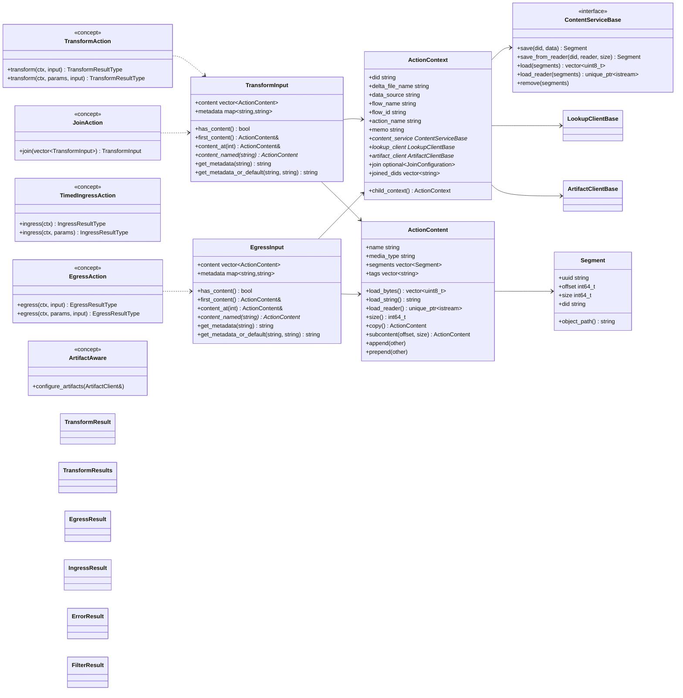
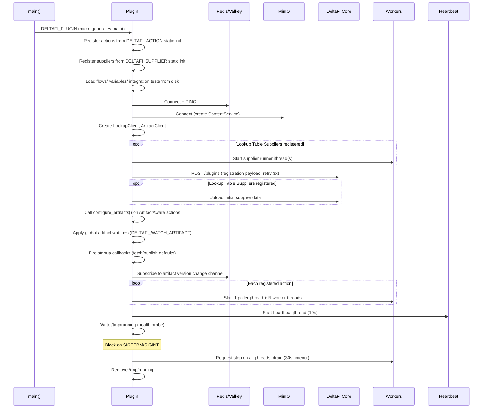
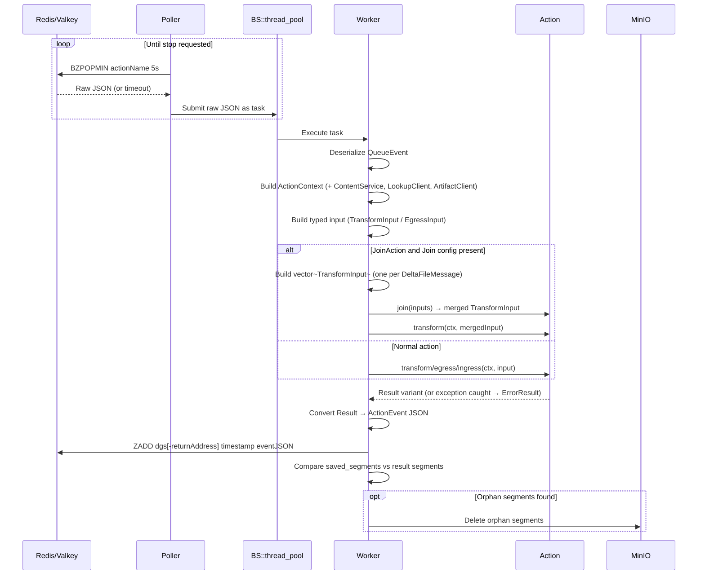

# DeltaFi C++ Action Kit — Design Document

The C++ Action Kit (`deltafi-cpp-action-kit`) is a header-only library that handles the boilerplate of communicating with DeltaFi core so that plugin authors only need to implement their action logic. It manages: polling for work from Redis/Valkey queues, executing actions, storing content in MinIO/S3, registering the plugin with core, querying lookup tables, managing artifacts, and sending heartbeats.

Java, Python, and Go action kits already exist. This document describes the C++ implementation.

---

## Header Layout

```
deltafi-cpp-action-kit/             # Header-only library
  CMakeLists.txt
  include/deltafi/
    action_kit.hpp                  # Umbrella include
    action.hpp                      # Action concepts (TransformAction, EgressAction, TimedIngressAction, JoinAction)
    artifact.hpp                    # ArtifactClient, publish/get, caching, version change callbacks
    content.hpp                     # ContentServiceBase, ContentService (S3), save/load helpers
    errors.hpp                      # Domain-specific error types (MissingMetadataError, ExpectedContentError)
    event.hpp                       # ActionEvent wire format (JSON published to result queue)
    heartbeat.hpp                   # Heartbeat jthread and long-running task reporting
    input.hpp                       # TransformInput, EgressInput, IngressInput
    log.hpp                         # LogMessage and LogSeverity constants
    lookup.hpp                      # LookupClient, LookupTableSupplierBase, supplier runner
    options.hpp                     # ActionOptions, InputSpec, OutputSpec, ContentSpec
    params.hpp                      # DELTAFI_PARAMS macro, EnvVar, DataSize
    plugin.hpp                      # Plugin struct, DELTAFI_PLUGIN macro, lifecycle orchestration
    queue.hpp                       # ActionEventQueue (Redis/Valkey BZPOPMIN/ZADD operations)
    registration.hpp                # PluginRegistration payload, HTTP POST to core with retry
    registry.hpp                    # Action/supplier registries, type-erased executors
    result.hpp                      # Result types: TransformResult, TransformResults, EgressResult, IngressResult, ErrorResult, FilterResult
    testing.hpp                     # InMemoryContentStore, MockLookupClient, MockArtifactClient, TestContext
    types.hpp                       # PluginCoordinates, Segment, ActionContent, ActionContext, Variable, FlowPlan, SafeStringMap
    worker.hpp                      # Poller, worker pool, action execution, join dispatch, orphan cleanup
    internal/
      crypto.hpp                    # SHA256/HMAC for AWS Signature V4
      resp_client.hpp               # RESP2 protocol client on Asio
      s3_client.hpp                 # Minimal S3 client on cpp-httplib
  vendor/
    nlohmann/json.hpp               # JSON parsing/serialization (MIT)
    httplib.h                       # HTTP client (MIT)
    asio/                           # Standalone Asio for async I/O (BSL-1.0)
    spdlog/                         # Structured logging, header-only mode (MIT)
    BS_thread_pool.hpp              # Worker thread pool (MIT)
    picosha2.h                      # SHA256 for AWS Signature V4 (MIT)
    catch2/                         # Unit testing framework (BSL-1.0)
```

---

## Type Model Diagram



---

## Plugin Lifecycle Sequence Diagram



---

## Action Execution Sequence Diagram



---

## Action Code Examples

### Transform Action with Typed Parameters

```cpp
// actions/upper_transform.hpp
#pragma once
#include <deltafi/plugin>

struct UpperTransformActionParams {
    std::string prefix = "HELLO";

    DELTAFI_PARAMS(UpperTransformActionParams,
        FIELD(prefix, "Prefix to prepend"))
};

class UpperTransformAction {
public:
    using Params = UpperTransformActionParams;

    deltafi::TransformResultType transform(deltafi::ActionContext& context,
                                            Params& params,
                                            deltafi::TransformInput& input) {
        auto data = input.first_content().load_string();
        auto output = params.prefix + ": " + data;
        std::transform(output.begin(), output.end(), output.begin(), ::toupper);

        deltafi::TransformResult result(context);
        result.save_content(output, input.first_content().name, "text/plain");
        return result;
    }
};

DELTAFI_ACTION(UpperTransformAction, "UpperTransformAction",
    "Uppercases content and prepends a prefix")
```

### Egress Action

```cpp
// actions/file_egress.hpp
#pragma once
#include <deltafi/plugin>

class FileEgressAction {
public:
    deltafi::EgressResultType egress(deltafi::ActionContext& context,
                                      deltafi::EgressInput& input) {
        auto& content = input.first_content();
        auto data = content.load_string();

        // Write to file...

        deltafi::EgressResult result(context);
        result.log_info() << "Wrote " << data.size() << " bytes to " << content.name;
        return result;
    }
};

DELTAFI_ACTION(FileEgressAction, "FileEgressAction",
    "Writes content to a local file")
```

### Timed Ingress Action with Memo

```cpp
// actions/polling_ingress.hpp
#pragma once
#include <deltafi/plugin>

class PollingIngressAction {
public:
    deltafi::IngressResultType ingress(deltafi::ActionContext& context) {
        int counter = 0;
        if (!context.memo.empty()) {
            try { counter = std::stoi(context.memo); } catch (...) {}
        }
        counter++;

        auto filename = "msg-" + std::to_string(counter) + ".txt";

        deltafi::IngressResult result(context);
        auto& item = result.create_item(filename);
        item.save_content("message " + std::to_string(counter), filename, "text/plain");

        result.set_memo(std::to_string(counter));
        return result;
    }
};

DELTAFI_ACTION(PollingIngressAction, "PollingIngressAction",
    "Creates a DeltaFile on each invocation with an incrementing counter")
```

### Join Action

```cpp
// actions/merging_transform.hpp
#pragma once
#include <deltafi/plugin>

class MergingTransformAction {
public:
    // Called before transform when multiple DeltaFileMessages arrive.
    deltafi::TransformInput join(std::vector<deltafi::TransformInput> inputs) {
        return deltafi::default_join(std::move(inputs));
    }

    deltafi::TransformResultType transform(deltafi::ActionContext& context,
                                            deltafi::TransformInput& input) {
        deltafi::TransformResult result(context);
        for (auto& c : input.content) {
            result.add_content(c);
        }
        return result;
    }
};

DELTAFI_ACTION(MergingTransformAction, "MergingTransformAction",
    "Merges multiple DeltaFiles into one")
```

### Multi-Child Split Transform

```cpp
// actions/split_transform.hpp
#pragma once
#include <deltafi/plugin>

class SplitTransformAction {
public:
    deltafi::TransformResultType transform(deltafi::ActionContext& context,
                                            deltafi::TransformInput& input) {
        deltafi::TransformResults results(context);

        for (size_t i = 0; i < input.content.size(); ++i) {
            auto& child = results.add_child(input.content[i].name);
            child.add_content(input.content[i]);
        }

        return results;
    }
};

DELTAFI_ACTION(SplitTransformAction, "SplitTransformAction",
    "Splits each input content item into a separate child DeltaFile")
```

### Plugin Entry Point

```cpp
// main.cpp
#include <deltafi/plugin>
#include "actions/upper_transform.hpp"
#include "actions/file_egress.hpp"
#include "actions/polling_ingress.hpp"

DELTAFI_PLUGIN(
    "org.deltafi",
    "my-plugin",
    "My DeltaFi C++ plugin",
    "org.deltafi.my-plugin"
)
```

---

## Lookup Table Service

### LookupClient API

The `LookupClient` is created automatically by the plugin and made available on every `ActionContext`. Actions query lookup tables through it:

```cpp
deltafi::LookupOptions opts;
opts.matching_column_values = {{"status", {"active"}}};
opts.result_columns = {"name", "value"};
opts.sort_column = "name";
opts.sort_direction = deltafi::SortDirection::ASC;
opts.offset = 0;
opts.limit = 100;

auto results = context.lookup_client->lookup("my-table", &opts);
// results.total_count, results.rows (vector<map<string,string>>), results.created, results.modified
```

### Caching

- Success TTL: 30s default, configurable via `TABLE_LOOKUP_CACHE_TTL` env var
- Failure TTL: 1s default, configurable via `TABLE_LOOKUP_FAILURE_CACHE_TTL`
- Cache key: SHA-256 of table name + serialized options

### LookupTableSupplier

Plugins can serve as lookup table data sources by implementing `LookupTableSupplierBase`:

```cpp
class LookupTableSupplierBase {
public:
    virtual LookupTableDefinition table() const = 0;
    virtual std::vector<std::map<std::string, std::string>> get_rows(
        const std::map<std::string, std::string>& variables,
        const std::map<std::string, std::vector<std::string>>& matching_column_values,
        const std::vector<std::string>& result_columns) = 0;
};
```

The `LookupTableDefinition` is included in registration and supports pull-through queries, refresh intervals, and key columns.

Suppliers are registered via `DELTAFI_SUPPLIER(MySupplier)` after the class definition. On startup:

1. The supplier runner jthread starts before registration (so it can respond to core queries during registration processing)
2. After registration, initial data is fetched from each supplier and uploaded via `POST /api/v2/lookup/{tableName}`
3. The runner listens for `lookupTableEvent` messages on per-table Redis queues, dispatches to the matching supplier, and publishes `lookupTableEventResult` responses

---

## Artifact Registry Service

### ArtifactClient API

The `ArtifactClient` is created automatically by the plugin and made available on every `ActionContext`. It publishes and retrieves artifacts via core's REST API (`/api/v2/artifacts`). Artifacts are scoped to the plugin's namespace or the `shared` namespace.

```cpp
auto& client = *context.artifact_client;

// Publish
deltafi::PublishOptions opts;
opts.version = "2.1";
opts.description = "Trained ML model";
opts.make_active = true;
opts.labels = {{"env", "prod"}};
auto resp = client.publish_artifact("model.bin", data, "application/octet-stream", &opts);

// Get (fully downloads into memory, cached)
auto fetched = client.get_artifact("model.bin", "active");
// fetched.data, fetched.manifest.version, fetched.manifest.sha256, ...

// Shared namespace variants
client.publish_shared_artifact(...)
client.get_shared_artifact(...)
```

### Caching

- Success TTL: 10s default, configurable via `ARTIFACT_CACHE_TTL` env var
- Failure TTL: 1s default, configurable via `ARTIFACT_FAILURE_CACHE_TTL`
- Cache is automatically invalidated when the same client publishes an artifact

### Version Change Callbacks

The artifact listener subscribes to the `deltafi:artifact:version-changed` Valkey pub/sub channel. When a version change event arrives:

1. The cache is invalidated for that artifact
2. Registered callbacks matching the event's owner, artifact name, and alias are invoked

Callback registration methods:

```cpp
// Auto-fetch callbacks (fetches artifact and passes to handler)
client.on_update_fetch("model.bin", handler);
client.on_shared_update_fetch("shared-config", handler);

// Auto-fetch with default (publishes default data if artifact not found)
client.on_update_fetch_with_default("rules.json", default_artifact, handler);

// Raw version change callbacks
client.on_update("model.bin", [](const VersionChangedEvent& event) { ... });
client.on_shared_update("config.json", [](const VersionChangedEvent& event) { ... });
```

### ArtifactAware Concept

Actions that need to register callbacks implement the `ArtifactAware` concept:

```cpp
class MyAction {
public:
    void configure_artifacts(deltafi::ArtifactClient& client) {
        client.on_update_fetch("my-data.json", [this](const FetchedArtifact* f, const std::string& err) {
            // update in-memory state
        });
    }
    // ...
};
```

Called once during plugin startup after registration but before workers begin processing.

### Plugin-Level Artifact Watches

For artifacts needed at the plugin level (not per-action), use the `DELTAFI_WATCH_ARTIFACT` macro:

```cpp
DELTAFI_WATCH_ARTIFACT(
    "config.json",
    deltafi::ArtifactDefault("config: []", "application/yaml", "Default config"),
    [](const deltafi::FetchedArtifact* fetched, const std::string& err) {
        // update in-memory config
    }
)
```

Plugin-level watches fire during startup, ensuring data is available when workers begin processing. The `DELTAFI_WATCH_SHARED_ARTIFACT` variant watches the shared namespace.

### Startup Sequence

1. `configure_artifacts()` is called on each `ArtifactAware` action
2. Global artifact watches (`DELTAFI_WATCH_ARTIFACT`) are applied
3. `fire_startup_callbacks()` fires all registered callbacks
4. The pub/sub listener starts for ongoing version change events

---

## JSON Schema Generation

`DELTAFI_PARAMS` generates a JSON Schema, `from_json`, and `to_json` for a C++ struct. C++20 lacks reflection, so a macro-based approach is used.

### Usage

```cpp
struct MyParams {
    std::string url;
    bool verbose = false;
    int max_retries = 3;

    DELTAFI_PARAMS(MyParams,
        FIELD(url, "Service URL"),
        FIELD(verbose, "Enable verbose logging"),
        FIELD(max_retries, "Maximum retry attempts"))
};
```

### Field Name Conversion

C++ `snake_case` field names are automatically converted to `camelCase` in JSON:
- `max_retries` → `"maxRetries"`
- `did_error_prefix` → `"didErrorPrefix"`

### Type Mapping

| C++ Type | JSON Schema Type |
|----------|-----------------|
| `std::string` | `"string"` |
| `bool` | `"boolean"` |
| `int`, `int64_t` | `"integer"` |
| `double` | `"number"` |
| `std::vector<T>` | `"array"` with `items` |
| `std::map<std::string, T>` | `"object"` with `additionalProperties` |
| `std::optional<T>` | Same as `T` (not in `required`) |
| Nested `DELTAFI_PARAMS` struct | Inline object schema |

Fields with default values are not marked as `required`. Fields without defaults (e.g., bare `std::string`) are `required`.

### Special Types

**`EnvVar`** — Stores an environment variable name (UPPER_SNAKE_CASE), resolved at runtime. Schema: `{"type":"string","pattern":"^[A-Z][A-Z0-9_]*$","x-deltafi-type":"EnvVar"}`.

```cpp
struct MyParams {
    deltafi::EnvVar api_key;
    DELTAFI_PARAMS(MyParams, FIELD(api_key, "API key from environment"))
};
// Usage: auto secret = params.api_key.resolve();
//        auto secret = params.api_key.resolve_or_default("fallback");
```

**`DataSize`** — Represents a size in bytes, parsed from human-readable strings like `"10MB"`. Schema: `{"type":"string","pattern":"^[0-9]+(B|KB|MB|GB|TB)$","x-deltafi-type":"DataSize"}`.

```cpp
struct MyParams {
    deltafi::DataSize max_size{"10MB"};
    DELTAFI_PARAMS(MyParams, FIELD(max_size, "Maximum file size"))
};
// Usage: auto bytes = params.max_size.bytes(); // 10485760
```

---

## Action Registration

### DELTAFI_ACTION Macro

Actions self-register via the `DELTAFI_ACTION` macro placed after the class definition:

```cpp
DELTAFI_ACTION(MyTransformAction, "MyTransformAction",
    "Transforms data by doing X")
```

This generates a `deltafi::action_traits<MyTransformAction>` specialization (providing `name` and `description`) and registers the action in the global registry at static initialization time.

### Action Concepts

The kit uses C++20 concepts for compile-time action type detection. An action must satisfy one of:

- `TransformAction` — has `transform(ctx, input)` or `transform(ctx, params, input)` returning `TransformResultType`
- `EgressAction` — has `egress(ctx, input)` or `egress(ctx, params, input)` returning `EgressResultType`
- `TimedIngressAction` — has `ingress(ctx)` or `ingress(ctx, params)` returning `IngressResultType`

Optionally:
- `JoinAction` — a `TransformAction` that also has `join(vector<TransformInput>)` returning `TransformInput`
- `HasParamsType` — declares a `Params` type with a `schema()` method (enables typed parameter parsing)
- `HasActionOptions` — declares a static `action_options()` method returning `ActionOptions`
- `ArtifactAware` — has `configure_artifacts(ArtifactClient&)`

### DELTAFI_PLUGIN Macro

Generates `main()` with the full plugin lifecycle:

```cpp
DELTAFI_PLUGIN(group, artifact, description, domain)
```

- `VERSION` is injected automatically via `-DVERSION=...` compile definition (defaults to `"0.0.0-dev"`)
- Actions and suppliers are auto-registered from DELTAFI_ACTION and DELTAFI_SUPPLIER static initializers

---

## ActionOptions

`ActionOptions` documents an action's expected inputs, outputs, error conditions, and filter conditions for the DeltaFi UI.

```cpp
static deltafi::ActionOptions action_options() {
    return {
        .description = "Transforms data by doing X",
        .input_spec = deltafi::InputSpec{
            .content_summary = "Expects a single JSON document",
        },
        .output_spec = deltafi::OutputSpec{
            .content_summary = "Produces a transformed JSON document",
            .metadata_descriptions = {
                {"outputKey", "Description of the output key"},
            },
        },
        .filters = deltafi::simple_filters({"Empty content"}),
        .errors = deltafi::simple_errors({"Invalid JSON input"}),
    };
}
```

- `InputSpec` — content_summary, content_specs, metadata_summary, metadata_descriptions
- `OutputSpec` — Same as InputSpec plus passthrough, annotations_summary, annotation_descriptions
- `simple_filters("reason1", "reason2")` / `simple_errors("error1", "error2")` — Shorthand for condition-less entries

---

## Test Framework

### In-Memory Content Store

`InMemoryContentStore` implements `ContentServiceBase` with a `map<string, vector<uint8_t>>`. Supports all operations: `save`, `save_from_reader`, `load`, `load_reader`, `remove`.

Convenience methods for test setup:

```cpp
store.create_content(did, name, media_type, data);          // returns ActionContent
store.create_string_content(did, name, media_type, str);    // returns ActionContent
```

### Mock Clients

**`MockLookupClient`** — Implements `LookupClientBase`. Configure via:
- `set_results(table_name, results)` for canned responses per table name
- `set_error(table_name, message)` for error responses
- `call_count()` records total calls for assertion

**`MockArtifactClient`** — Implements `ArtifactClientBase`. Configure via:
- `set_artifact(name, alias, fetched)` for canned get responses
- `publish_count()` records total publish calls for assertion

### TestContext

```cpp
auto tc = deltafi::testing::new_test_context("test-did-123");
// tc.action_context — pre-wired with InMemoryContentStore, test defaults
// tc.store — the underlying InMemoryContentStore

auto content = tc.content("file.txt", "text/plain", "hello world");

deltafi::TransformInput input;
input.content = {content};
input.metadata = {{"key", "value"}};
```

The `ActionContext` is pre-populated with test values (DID, flow name, action name, etc.) and wired to the in-memory content store.

### Action Runners

```cpp
auto event = deltafi::testing::run_transform(action, tc.action_context, input);
auto event = deltafi::testing::run_transform(action, tc.action_context, params, input);
auto event = deltafi::testing::run_egress(action, tc.action_context, input);
auto event = deltafi::testing::run_ingress(action, tc.action_context);
```

### Result Assertions

```cpp
auto& transforms = deltafi::testing::require_transform(event);  // asserts type=TRANSFORM
auto& error = deltafi::testing::require_error(event, "bad input"); // asserts type=ERROR with matching cause
auto& filter = deltafi::testing::require_filter(event, "too small"); // asserts type=FILTER
deltafi::testing::require_egress(event);                         // asserts type=EGRESS
auto& ingress = deltafi::testing::require_ingress(event);        // asserts type=INGRESS
```

### ResultEvent

For lower-level inspection, `result_event(result, actx)` converts any result variant to an `ActionEvent` with all fields accessible.

---

## Multi-Child Splitting

Transform actions can produce multiple child DeltaFiles from a single input using `TransformResults`:

```cpp
deltafi::TransformResults results(context);

auto& child1 = results.add_child("part-1.txt");
child1.add_content(content1);
child1.add_metadata("index", "1");

auto& child2 = results.add_child("part-2.txt");
child2.add_content(content2);

return results;
```

`add_child()` calls `context.child_context()`, which generates a new UUID for the child DeltaFile while inheriting the parent's flow context, content service, lookup client, and artifact client.

Each child produces a separate `TransformEvent` in the `ActionEvent.transform` array, each with its own DID, content, metadata, and annotations.

---

## Content Operations

### Save

```cpp
// Via result (saves and adds to result)
auto& content = result.save_content(data_string, "output.json", "application/json");
auto& content = result.save_content(data_bytes, "output.bin", "application/octet-stream");

// Via free functions (saves and tracks segment on context)
auto content = deltafi::save_content(cs, actx, data_bytes, "output.json", "application/json");
auto content = deltafi::save_content_string(cs, actx, str, "output.json", "application/json");
auto content = deltafi::save_content_from_reader(cs, actx, reader, size, "output.bin", "application/octet-stream");
```

All save operations track segments on the ActionContext for orphan cleanup.

### Load

```cpp
auto bytes = content.load_bytes();               // vector<uint8_t>
auto str = content.load_string();                 // string
auto reader = content.load_reader();              // unique_ptr<istream>
```

### Manipulate (no I/O)

```cpp
auto copied = content.copy();                                           // deep copy
auto sub = content.subcontent(offset, size);                            // byte range view
auto sub = content.subcontent_named(offset, size, "part", "text/plain");

content.append(other);           // append other's segments
content.prepend(other);          // prepend other's segments
content.set_name("new.txt");
content.set_media_type("text/plain");
content.add_tag("processed");
content.remove_tag("raw");
bool has = content.has_tag("processed");
int64_t total = content.size();  // sum of segment sizes
```

`subcontent` adjusts segment offsets and sizes to reference a byte range without fetching data from storage.

---

## Threading Model

```
Main Thread
  └── Plugin::run()
        ├── Registration (synchronous, retries: 500ms, 2s, 5s)
        ├── Per-action group:
        │   ├── 1 Poller std::jthread
        │   │   └── BZPOPMIN loop on dedicated RespConnection
        │   └── N Workers via BS::thread_pool (default 1, configurable)
        │       └── Deserialize → execute → ZADD result → orphan cleanup
        ├── 1 Heartbeat std::jthread (10s ticker)
        │   └── HSET heartbeat + track/report long-running tasks (>30s)
        ├── 1 Supplier runner std::jthread (if suppliers registered)
        │   └── BZPOPMIN loop for lookup table event queues
        ├── 1 Artifact listener std::jthread
        │   └── SUBSCRIBE to version-changed channel
        ├── 1 Health probe (create /tmp/running)
        └── Signal handler (SIGTERM/SIGINT)
            └── Request stop on all jthreads → drain workers (30s) → cleanup
```

---

## Environment Variables

| Variable | Default | Description |
|----------|---------|-------------|
| `CORE_URL` | `http://deltafi-core-service` | DeltaFi core API URL |
| `VALKEY_URL` | `deltafi-valkey-master:6379` | Redis/Valkey host:port |
| `VALKEY_PASSWORD` | `""` | Redis/Valkey password |
| `MINIO_URL` | `deltafi-minio:9000` | MinIO endpoint (scheme prefix stripped) |
| `MINIO_ACCESSKEY` | `deltafi` | MinIO access key |
| `MINIO_SECRETKEY` | `password` | MinIO secret key |
| `STORAGE_BUCKET_NAME` | `storage` | S3 bucket name |
| `IMAGE` | `""` | Container image URI |
| `IMAGE_PULL_SECRET` | `""` | K8s image pull secret |
| `PROJECT_GROUP` | `""` | Plugin group ID (PluginCoordinates.group_id) |
| `PROJECT_NAME` | `""` | Plugin artifact ID (also used as display name fallback) |
| `PROJECT_VERSION` | `""` | Plugin version |
| `APP_NAME` | (hostname) | Container/pod name for task tracking |
| `ACTION_THREADS` | `1` | Default worker count for all actions |
| `ACTIONS_ACTIONTHREADS_{NAME}` | (none) | Per-action worker count override (dots/hyphens → underscores, uppercased) |
| `TABLE_LOOKUP_CACHE_TTL` | `30s` | Lookup result cache TTL |
| `TABLE_LOOKUP_FAILURE_CACHE_TTL` | `1s` | Lookup failure cache TTL |
| `ARTIFACT_CACHE_TTL` | `10s` | Artifact download cache TTL |
| `ARTIFACT_FAILURE_CACHE_TTL` | `1s` | Artifact failure cache TTL |

---

## Dependencies

All vendored in `vendor/` as header-only libraries. No runtime downloads or compiled third-party artifacts.

| Library | Version | License | Role |
|---------|---------|---------|------|
| nlohmann/json | 3.11.x | MIT | JSON parsing/serialization |
| cpp-httplib | 0.16.x | MIT | HTTP client (registration, S3, lookup, artifact) |
| Asio (standalone) | 1.30.x | BSL-1.0 | Async I/O for RESP client |
| spdlog | 1.14.x | MIT | Structured logging (header-only mode) |
| BS::thread_pool | 4.1.x | MIT | Worker thread pool |
| PicoSHA2 | 1.0.0 | MIT | SHA256 for AWS Signature V4 (S3 content storage) |
| Catch2 | 3.x | BSL-1.0 | Unit testing framework |
