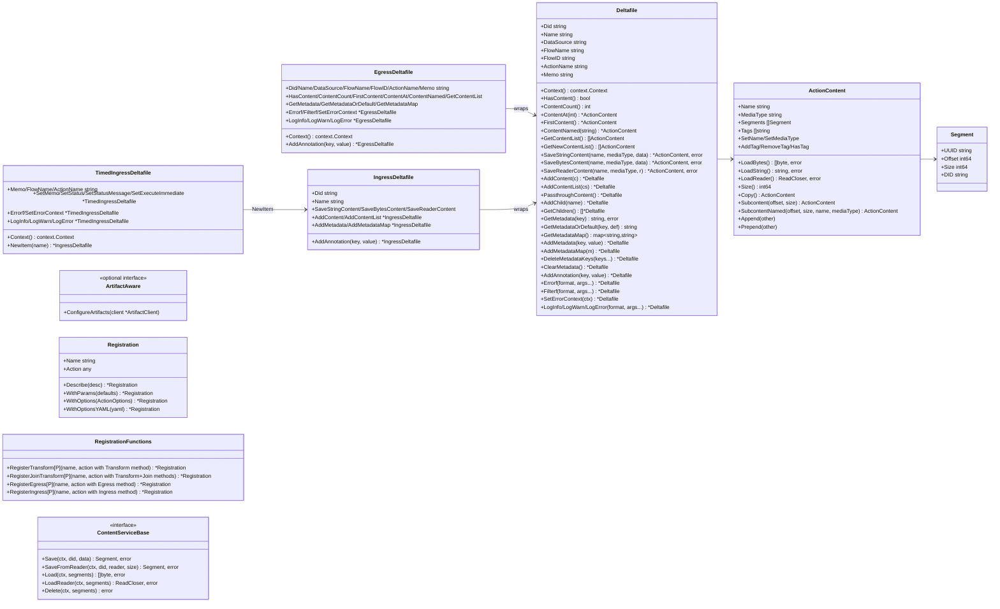
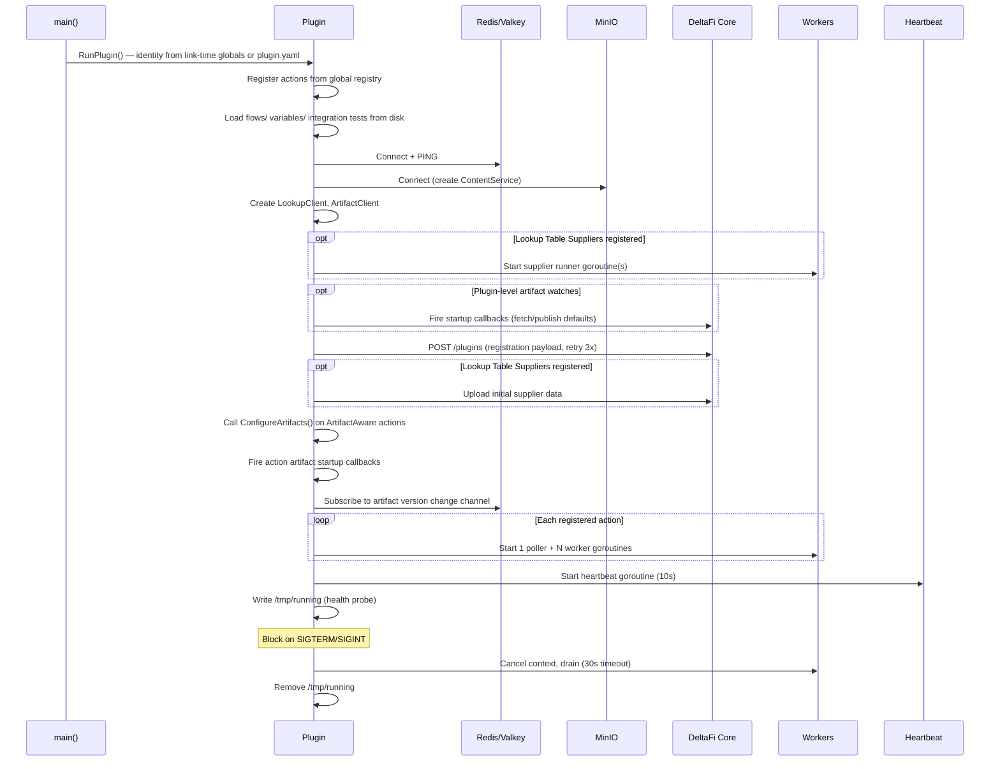
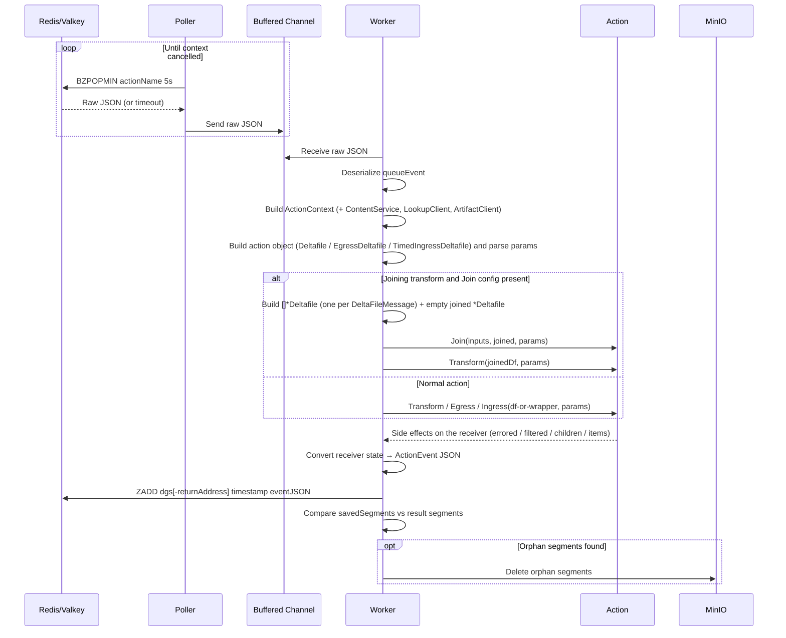

# DeltaFi Go Action Kit — Design Document

The Go Action Kit (`deltafi-go-action-kit`) is a library that handles the boilerplate of communicating with DeltaFi core so that plugin authors only need to implement their action logic. It manages: polling for work from Redis/Valkey queues, executing actions, storing content in MinIO/S3, registering the plugin with core, querying lookup tables, managing artifacts, and sending heartbeats.

Java and Python action kits already exist. This document describes the Go implementation.

---

## Module Layout

```
deltafi-go-action-kit/            # Library — flat package: actionkit
  go.mod
  actionkit.go                    # PluginCoordinates, ActionContext (internal), Variable, FlowPlan, SafeStringMap
  action.go                       # Action type constants, ArtifactAware optional interface
  artifact.go                     # ArtifactClient, publish/get/stream, caching, version change callbacks
  content.go                      # Segment, ActionContent, ContentService (MinIO), package-level Save helpers
  datasize.go                     # DataSize parameter type (human-readable byte sizes)
  deltafile.go                    # Deltafile — primary action object; content/metadata/annotation/children
  dispatch.go                     # Per-action typed closures built at registration; event builders for the 4 action types
  egress_deltafile.go             # EgressDeltafile — restricted view passed to Egress actions
  envvar.go                       # EnvVar parameter type (UPPER_SNAKE_CASE env var references)
  errors.go                       # Domain-specific error types (MissingMetadataError, ExpectedContentError)
  event.go                        # ActionEvent wire format (JSON published to result queue)
  globals.go                      # Package-level Lookup / GetArtifact / PublishArtifact / StreamArtifact
  heartbeat.go                    # Heartbeat goroutine and long-running task reporting
  httpclient.go                   # Shared HTTP transports used by registration, artifact, and lookup clients
  input.go                        # Type-aware parameter coercion (string → numeric/bool, map → struct)
  log.go                          # LogMessage and LogSeverity constants
  lookup.go                       # LookupClient, LookupTableSupplier, pull-through supplier runner
  lookup_query.go                 # LookupQueryBuilder — fluent query construction with client-side exclusion
  options.go                      # ActionOptions, InputSpec, OutputSpec, ContentSpec
  plugin.go                       # Plugin struct, RunPlugin(), lifecycle orchestration
  queue.go                        # ActionEventQueue (Redis/Valkey BZPOPMIN/ZADD operations)
  registration.go                 # pluginRegistration payload, HTTP POST to core with retry
  registry.go                     # Global action/supplier/watch registries, Registration builder
  schema.go                       # JSON Schema generation with $ref resolution and default coercion
  testing.go                      # InMemoryContentStore, MockLookupClient, MockArtifactClient, TestContext, RunX helpers
  timed_ingress_deltafile.go      # TimedIngressDeltafile (action container) + IngressDeltafile (per-item write-only)
  worker.go                       # Poller, worker pool, action execution, join dispatch, orphan cleanup
  cmd/
    actionkit-schemagen/          # Standalone CLI for jsonFromParams / paramsFromJson round-trip
```

---

## Type Model Diagram

Actions are plain Go structs. Each action type is identified by the presence of a conventionally-named method (`Transform`, `Egress`, `Ingress`, `Join`) on the struct. The generic `RegisterX` functions enforce method signatures at compile time via interface constraints — there are no Go `interface`s for the action types themselves, and there is no reflection at the invocation hot path (each registration builds a typed closure that calls the action method directly).



### Method signatures enforced at registration

| Action type | Required method(s) | Registered via |
|---|---|---|
| Transform | `Transform(*Deltafile, P) *Deltafile` | `RegisterTransform[P]` |
| Joining transform | `Transform(*Deltafile, P) *Deltafile` and `Join([]*Deltafile, *Deltafile, P) *Deltafile` | `RegisterJoinTransform[P]` |
| Egress | `Egress(*EgressDeltafile, P) *EgressDeltafile` | `RegisterEgress[P]` |
| Timed ingress | `Ingress(*TimedIngressDeltafile, P) *TimedIngressDeltafile` | `RegisterIngress[P]` |

`P` is the action's parameter struct type, inferred by Go from the method signature. Returning the same Deltafile-shaped object is a convention for chaining; the dispatcher inspects the receiver's state (children, errored, filtered, items) to build the wire event, so the returned value is otherwise unused.

---

## Plugin Lifecycle Sequence Diagram



---

## Action Execution Sequence Diagram



---

## Parameter File Convention and Schema Round-Trip

Each action's typed parameter struct lives in its own file beside the action:

```
actions/
  foo_action.go               # action struct, init(), action method
  foo_action_params.go        # FooActionParams struct (and any nested param-shape types)
  foo_action_params.json      # optional — generated by jsonFromParams
  foo_action.yaml             # ActionOptions for the DeltaFi UI
  foo_action_test.go
```

Splitting the params struct into a sibling file keeps the action's logic separate from its public configuration surface and gives the round-trip tooling a deterministic location to read from and write to.

The kit ships a single binary, `cmd/actionkit-schemagen`, that converts between the two representations:

```sh
go run gitlab.com/deltafi/deltafi/deltafi-go-action-kit/v2/cmd/actionkit-schemagen json   ./actions
go run gitlab.com/deltafi/deltafi/deltafi-go-action-kit/v2/cmd/actionkit-schemagen params ./actions
```

Each plugin's `Makefile` exposes these as `jsonFromParams` and `paramsFromJson` targets. Both directions are pure file-by-file AST/text — the plugin does **not** need to compile for either to work.

### `jsonFromParams` (Go → JSON Schema)

Walks `*_action_params.go`, parses each file with `go/ast`, locates the `*Params` struct (and any named companion structs defined in the same file), and writes a `*_action_params.json` schema next to each. The AST generator reproduces the kit's reflect-based `GenerateSchema` output byte-for-byte for the supported subset, so the schemas on disk match exactly what the kit sends to core during plugin registration. Equivalence is locked in by golden tests in the schemagen package.

The supported subset, mirroring the reflect path:

* Field types: Go primitives (`bool`, `int*`, `uint*`, `float32/64`, `string`), pointers, slices, string-keyed maps, named struct types defined in the same file, and `actionkit.DataSize` / `actionkit.EnvVar`.
* Struct tags: `json`, `description`, `default`, `enum`, `required`, `minimum`, `maximum`.
* Output features: `additionalProperties: false`, `title` on named struct schemas (used by `paramsFromJson` to recover Go type names on the reverse trip), and the kit's `x-deltafi-type` markers for DataSize/EnvVar.

### `paramsFromJson` (JSON Schema → Go)

Walks `*_action_params.json`, parses each schema, and writes the matching `*_action_params.go` source. The reverse direction is canonical, not diff-clean against a hand-written original:

* Fields emit in alphabetical order.
* Doc comments on Go types are not represented in JSON Schema, so they are lost; the kit emits boilerplate comments instead.
* Slice-of-named-struct fields (`[]Foo`) round-trip as slice-of-pointer (`[]*Foo`).
* Pointer-vs-value choice is normalized to pointer for nested struct fields.

Round-tripping is idempotent from the first JSON onward (Go → JSON → Go → JSON gives the same JSON in steps 1 and 4).

---

## Action Code Examples

### Transform Action with Typed Parameters

```go
package actions

import (
    "strings"

    ak "gitlab.com/deltafi/deltafi/deltafi-go-action-kit/v2"
)

type UpperParams struct {
    Prefix string `json:"prefix" jsonschema:"description=Prefix to prepend,default=HELLO"`
}

type UpperTransform struct{}

func init() {
    ak.RegisterTransform("UpperTransform", &UpperTransform{}).
        Describe("Uppercases content and prepends a prefix").
        WithParams(UpperParams{Prefix: "HELLO"})
}

func (a *UpperTransform) Transform(df *ak.Deltafile, params UpperParams) *ak.Deltafile {
    content, err := df.FirstContent()
    if err != nil {
        return df.Errorf("no content provided")
    }
    data, err := content.LoadString()
    if err != nil {
        return df.Errorf("load content: %v", err)
    }
    if _, err := df.SaveStringContent(
        content.Name, "text/plain",
        params.Prefix+": "+strings.ToUpper(data)); err != nil {
        return df.Errorf("save content: %v", err)
    }
    return df
}
```

### Egress Action

`Egress` actions receive an `*EgressDeltafile` — a constrained view that exposes content/metadata reads, logging, annotations, and error/filter signaling, but not output-content or metadata mutations.

```go
type FileEgress struct{}

func init() {
    ak.RegisterEgress("FileEgress", &FileEgress{}).
        Describe("Writes content to a local file")
}

func (a *FileEgress) Egress(df *ak.EgressDeltafile, params struct{}) *ak.EgressDeltafile {
    content, err := df.FirstContent()
    if err != nil {
        return df.Errorf("no content provided")
    }
    data, err := content.LoadBytes()
    if err != nil {
        return df.Errorf("load content: %v", err)
    }
    if err := os.WriteFile("/tmp/"+content.Name, data, 0644); err != nil {
        return df.Errorf("write file: %v", err)
    }
    return df.LogInfo("Wrote %d bytes to %s", len(data), content.Name)
}
```

### Timed Ingress Action with Memo

A timed ingress action receives a single `*TimedIngressDeltafile` that carries per-cycle context (`Memo`, `FlowName`, `ActionName`), spawns ingress items via `NewItem`, and records event-level state (`SetMemo`, `SetStatus`, `SetExecuteImmediate`, `Errorf`, `LogInfo`/`LogWarn`/`LogError`). Each `NewItem` returns an `*IngressDeltafile` — a write-only Deltafile view that exposes only the writes the wire event carries (`Save*`, `AddContent`, `AddMetadata`, `AddAnnotation`).

```go
type PollingIngress struct{}

func init() {
    ak.RegisterIngress("PollingIngress", &PollingIngress{}).
        Describe("Creates a DeltaFile on each invocation with an incrementing counter")
}

func (a *PollingIngress) Ingress(deltafile *ak.TimedIngressDeltafile, params struct{}) *ak.TimedIngressDeltafile {
    counter := 0
    if deltafile.Memo != "" {
        fmt.Sscanf(deltafile.Memo, "%d", &counter)
    }
    counter++

    item := deltafile.NewItem(fmt.Sprintf("msg-%d.txt", counter))
    if _, err := item.SaveStringContent(
        "message.txt", "text/plain", fmt.Sprintf("message %d", counter)); err != nil {
        return deltafile.Errorf("save content: %v", err)
    }
    return deltafile.SetMemo(strconv.Itoa(counter))
}
```

### Joining Transform Action

A joining transform implements both `Join` and `Transform`. `Join` is called first with one input `*Deltafile` per joined DeltaFile and an empty `joined *Deltafile` to populate; the kit then invokes `Transform` on a freshly built Deltafile that carries the content/metadata produced by `Join`.

```go
type MergingTransform struct{}

func init() {
    ak.RegisterJoinTransform("MergingTransform", &MergingTransform{}).
        Describe("Merges multiple DeltaFiles into one")
}

func (a *MergingTransform) Join(inputs []*ak.Deltafile, joined *ak.Deltafile, params struct{}) *ak.Deltafile {
    for _, in := range inputs {
        joined.AddContentList(in.GetContentList())
        joined.AddMetadataMap(in.GetMetadataMap())
    }
    return joined
}

func (a *MergingTransform) Transform(df *ak.Deltafile, params struct{}) *ak.Deltafile {
    return df.LogInfo("merged %d content items", df.ContentCount())
}
```

### Multi-Child Split Transform

Split actions are transform actions that create children via `df.AddChild(name)`. When children are present after the action returns, the kit emits a multi-child transform event automatically; if no children are added, a single transform event is emitted instead. The same action method can choose either outcome at runtime.

```go
type SplitTransform struct{}

func init() {
    ak.RegisterTransform("SplitTransform", &SplitTransform{}).
        Describe("Splits each input content item into a separate child DeltaFile")
}

func (a *SplitTransform) Transform(df *ak.Deltafile, params struct{}) *ak.Deltafile {
    for _, content := range df.GetContentList() {
        child := df.AddChild(content.Name)
        child.AddContent(content)
        child.AddMetadataMap(df.GetMetadataMap())
    }
    return df
}
```

---

## Result Precedence

The dispatcher converts a `*Deltafile` returned by a transform action into an `*ActionEvent` using a fixed precedence order.

1. **Nil return** — if the action returns `nil`, the dispatcher emits an error event with the message `"action returned nil Deltafile"`.
2. **Children present** — if `len(df.children) > 0`, the dispatcher emits a multi-child transform event immediately. **This check runs before the error/filter check.** Calling both `AddChild` and `Errorf` on the same Deltafile drops the error silently — splits and error paths must be mutually exclusive.
3. **Error state** — when `hasError` is true, the dispatcher emits an error event. Output content is suppressed; annotations and log messages are carried onto the event.
4. **Filter state** — when `hasFilter` is true, the dispatcher emits a filter event. Output content is suppressed; annotations and log messages are carried onto the event.
5. **Normal transform** — output content, metadata changes, annotations, and log messages are collected into a transform event.

### Errorf / Filterf are mutually exclusive

`Errorf` and `Filterf` each clear the other's flag, so the last call wins:

```go
df.Filterf("no match").Errorf("boom") // → error event (Errorf called last)
df.Errorf("boom").Filterf("no match") // → filter event (Filterf called last)
```

### Children short-circuit the error/filter check — a footgun

```go
func (a *SplitAction) Transform(df *ak.Deltafile, params P) *ak.Deltafile {
    child := df.AddChild("part-1")
    child.AddContent(content)
    if somethingWrong {
        return df.Errorf("abort") // Errorf has no effect — children take precedence
    }
    return df
}
```

If an error arises after children have been added, do not call `Errorf` on the parent — it will be dropped. Arrange the code so that children are added only after all error conditions have been checked.

### Annotations vs. content on error/filter events

Annotations added via `df.AddAnnotation` **do** appear on error and filter events (they are stored in `ErrorEvent.Annotations` / `FilterEvent.Annotations`). Output content added via `Save*` or `AddContent` does **not** — `event.Transform` is empty or nil on error and filter events. Metadata changes (`df.AddMetadata` / `df.DeleteMetadataKeys`) are likewise **not** carried onto error or filter events; metadata mutations are only emitted as part of a normal transform event.

---

## Concurrency Contract

Registered action structs are **shared singletons**: the same instance is used by all worker goroutines concurrently. The kit passes a fresh `*Deltafile` (or `*EgressDeltafile` / `*TimedIngressDeltafile`) and a freshly parsed `params` value to each invocation, but the action struct itself is shared.

Any field written during `Transform`, `Egress`, or `Ingress` is therefore a data race unless protected by a mutex or other concurrency primitive.

### Keep actions stateless

The idiomatic pattern is a stateless struct:

```go
type UpperTransform struct{} // no mutable fields

func (a *UpperTransform) Transform(df *ak.Deltafile, p UpperParams) *ak.Deltafile {
    // all state lives in df and p — safe under concurrent invocations
}
```

### Guard shared state when needed

When an action holds state — for example, artifact data cached via `ConfigureArtifacts` — use a concurrency-safe container:

```go
type MyTransform struct {
    config actionkit.SafeStringMap // reads and writes safe across goroutines
}
```

`SafeStringMap` is provided by the kit for this purpose. For arbitrary shared data, a `sync.RWMutex`-protected field works.

### Verify with the race detector

Run `go test -race ./...` (or `make test`) to surface data races under concurrent load. When testing with multiple worker goroutines, set `ACTION_THREADS` to a value greater than 1 so the race detector sees actual concurrent calls.

### Per-execution instances are not provided

A factory API that creates a new action instance per execution is intentionally absent — it would obscure the shared-singleton model and encourage accidental per-call allocation. Favor stateless actions; when state is genuinely needed, protect it explicitly.

---

## Lookup Table Service

### Lookup API

Action code queries lookup tables via the package-level `actionkit.Lookup` function. The plugin's `LookupClient` is initialized during `RunPlugin` and stored in package-level state, so action authors do not plumb a client through. Queries are built with `LookupQuery()`, a fluent `*LookupQueryBuilder`:

```go
results, err := actionkit.Lookup("my-table",
    actionkit.LookupQuery().
        WithMatch("status", "active").
        WithResultColumns("name", "value").
        WithSort("name", actionkit.SortASC).
        WithLimit(100))

// results.TotalCount, results.Rows ([]Row; access values with Row.Get(col)), results.Created, results.Modified
```

Pass `nil` as the query to fetch all rows. `WithMatch` may be chained multiple times to add columns or accumulate values for the same column; `ExcludingMatch` adds rows-to-drop criteria that are applied client-side after the query returns.

### Caching

- Success TTL: 30s default, configurable via `TABLE_LOOKUP_CACHE_TTL` env var or `SetCacheTTL()`
- Failure TTL: 1s default, configurable via `TABLE_LOOKUP_FAILURE_CACHE_TTL`
- Cache key: SHA-256 of table name + serialized options
- `ClearCache()` evicts all entries

### LookupTableSupplier

Plugins can serve as lookup table data sources by implementing `LookupTableSupplier`:

```go
type LookupTableSupplier interface {
    Table() LookupTableDefinition
    GetRows(ctx, variables map[string]string, matchingColumnValues map[string][]string,
            resultColumns []string) ([]Row, error)
}
```

The `LookupTableDefinition` is included in registration and supports pull-through queries, refresh intervals, and key columns.

Suppliers are registered via `actionkit.RegisterSupplier(supplier)` from `init()`. On startup:

1. The supplier runner goroutine starts before registration (so it can respond to core queries during registration processing)
2. After registration, initial data is fetched from each supplier and uploaded via `POST /api/v2/lookup/{tableName}`
3. The runner listens for `lookupTableEvent` messages on per-table Redis queues, dispatches to the matching supplier, and publishes `lookupTableEventResult` responses

### Table Upload

```go
client.UploadTable(ctx, "my-table", "application/json", jsonData)
// or
client.UploadTable(ctx, "my-table", "text/csv", csvData)
```

---

## Artifact Registry Service

### Artifact API

Action code uses the package-level functions in `globals.go` to publish and retrieve artifacts. The plugin's `ArtifactClient` is initialized during `RunPlugin` and stored in package-level state, so action authors do not plumb a client through. Artifacts are scoped to the plugin's namespace or the `shared` namespace; pass an empty alias to default to `"active"`.

```go
// Publish to the plugin's namespace
resp, err := actionkit.PublishArtifact("model.bin", reader, "application/octet-stream",
    &actionkit.PublishOptions{
        Version:     "2.1",
        Description: "Trained ML model",
        MakeActive:  boolPtr(true),
        Alias:       "production",
        Labels:      map[string]string{"env": "prod"},
    })

// Get (fully downloads into memory, cached)
fetched, err := actionkit.GetArtifact("model.bin", "active")
// fetched.Data, fetched.Manifest.Version, fetched.Manifest.SHA256, ...

// Stream (bypasses cache, caller must close Reader)
stream, err := actionkit.StreamArtifact("model.bin", "active")
defer stream.Reader.Close()

// Shared namespace variants
actionkit.PublishSharedArtifact(...)
actionkit.GetSharedArtifact(...)
actionkit.StreamSharedArtifact(...)
```

The package-level helpers delegate to the same `*ArtifactClient` instance that is passed to `ArtifactAware.ConfigureArtifacts` (see below); when an action needs to register version-change callbacks it works against the client directly.

### Caching

- Success TTL: 10s default, configurable via `ARTIFACT_CACHE_TTL` env var or `SetCacheTTL()`
- Failure TTL: 1s default, configurable via `ARTIFACT_FAILURE_CACHE_TTL`
- Cache is automatically invalidated when the same client publishes an artifact
- `ClearCache()` evicts all entries
- Stream operations bypass the cache entirely

### Version Change Callbacks

The artifact listener subscribes to the `deltafi:artifact:version-changed` Valkey pub/sub channel. When a version change event arrives:

1. The cache is invalidated for that artifact
2. Registered callbacks matching the event's owner, artifact name, and alias are invoked

Callback registration methods:

```go
// Raw event callback
client.OnUpdate("model.bin", "active", func(event VersionChangedEvent) { ... })
client.OnSharedUpdate("config.json", "", func(event VersionChangedEvent) { ... })

// Auto-fetch callbacks (fetches artifact and passes to handler)
client.OnUpdateFetch("model.bin", "", func(fetched *FetchedArtifact, err error) { ... })
client.OnSharedUpdateFetch("shared-config", "", func(fetched *FetchedArtifact, err error) { ... })

// Auto-fetch with default (publishes default data if artifact not found)
client.OnUpdateFetchWithDefault("rules.json", "", defaultArtifact, handler)
client.OnSharedUpdateFetchWithDefault("shared-rules.json", "", defaultArtifact, handler)
```

### ArtifactAware Interface

Actions that need to register callbacks implement `ArtifactAware`:

```go
type ArtifactAware interface {
    ConfigureArtifacts(client *ArtifactClient)
}
```

Called once during plugin startup after registration but before workers begin processing.

### Plugin-Level Artifact Watches

For artifacts needed at the plugin level (not per-action), use the global registry:

```go
func init() {
    actionkit.WatchArtifact("config.json", &actionkit.ArtifactDefault{
        Data:        defaultConfigBytes,
        ContentType: "application/json",
        Description: "Default configuration",
    }, func(fetched *actionkit.FetchedArtifact, err error) {
        // update in-memory config
    })
}
```

Plugin-level watches fire before registration, ensuring data is available when core processes the registration.

### WatchArtifact Startup Sequence

1. Plugin-level watches (`WatchArtifact`/`WatchSharedArtifact`) are set up and fired before registration
2. After registration, `ConfigureArtifacts()` is called on each `ArtifactAware` action
3. `FireStartupCallbacks()` fires any callbacks added during step 2
4. The pub/sub listener starts for ongoing version change events

---

## Artifact Watch-and-Cache Pattern

The idiomatic way to consume an artifact in an action is to implement `ArtifactAware`, register version-change callbacks in `ConfigureArtifacts`, and cache parsed data in concurrency-safe fields on the action struct. Callbacks fire once at startup (after plugin registration) and again on each version change — avoiding a remote fetch on every action invocation.

### Pattern summary

1. **Implement `ArtifactAware`** by adding `ConfigureArtifacts(*ArtifactClient)` to the action struct.
2. **Register callbacks** with `OnUpdateFetch` or `OnUpdateFetchWithDefault`. `OnUpdateFetchWithDefault` publishes a default artifact the first time the artifact is absent, then fetches it.
3. **Cache parsed state** in a `SafeStringMap` or other concurrency-safe field — the callback may fire from any goroutine.
4. **Read cached state** inside `Transform` / `Egress` — avoid calling `GetArtifact` on every execution.
5. **Use `StreamArtifact`** inside an `OnUpdate` callback for large artifacts that should never be loaded into memory.

### Example (from hello-world `transform_action.go`)

```go
type HelloWorldGoTransformAction struct {
    extraMetadata    actionkit.SafeStringMap
    extraAnnotations actionkit.SafeStringMap
}

func (a *HelloWorldGoTransformAction) ConfigureArtifacts(client *actionkit.ArtifactClient) {
    client.OnUpdateFetchWithDefault("metadata.json", "",
        actionkit.ArtifactDefault{
            Data:        []byte(`{"custom": "value"}`),
            ContentType: "application/json",
            Description: "Default extra metadata",
        },
        func(fetched *actionkit.FetchedArtifact, err error) {
            a.ExtraMetadataCallback(fetched, err)
        })
    client.OnSharedUpdateFetchWithDefault("annotations.json", "",
        actionkit.ArtifactDefault{...},
        func(fetched *actionkit.FetchedArtifact, err error) {
            a.ExtraAnnotationsCallback(fetched, err)
        })
}

func (a *HelloWorldGoTransformAction) ExtraMetadataCallback(artifact *actionkit.FetchedArtifact, err error) {
    if err != nil {
        log.Printf("Unable to read metadata.json: %v", err)
        a.extraMetadata.Store(nil)
        return
    }
    var metadata map[string]string
    if err := json.Unmarshal(artifact.Data, &metadata); err != nil {
        a.extraMetadata.Store(nil)
        return
    }
    a.extraMetadata.Store(metadata)
}

func (a *HelloWorldGoTransformAction) Transform(df *actionkit.Deltafile, params P) *actionkit.Deltafile {
    // Read cached state — no remote call.
    a.extraMetadata.ForEach(func(k, v string) { df.AddMetadata(k, v) })
    ...
}
```

### Callback registration variants

| Method | Behavior |
|--------|----------|
| `client.OnUpdate(name, alias, fn)` | Raw event callback — no automatic fetch |
| `client.OnUpdateFetch(name, alias, fn)` | Fetches artifact on each version change |
| `client.OnUpdateFetchWithDefault(name, alias, default, fn)` | As above; publishes `default` if artifact is absent at startup |
| `client.OnSharedUpdate(...)` | Raw callback in the shared artifact namespace |
| `client.OnSharedUpdateFetch(...)` | Auto-fetch in the shared namespace |
| `client.OnSharedUpdateFetchWithDefault(...)` | Auto-fetch with default in the shared namespace |

Pass an empty alias to default to the `"active"` alias.

### Large artifacts

When an artifact is too large to load into memory, use `StreamArtifact` inside an `OnUpdate` callback:

```go
client.OnUpdate("large-model.bin", "active", func(event actionkit.VersionChangedEvent) {
    stream, err := actionkit.StreamArtifact("large-model.bin", "active")
    if err != nil {
        // handle
        return
    }
    defer stream.Reader.Close()
    // process stream incrementally; update cached state when done
})
```

---

## JSON Schema Generation

`GenerateSchema(paramType any) map[string]any` produces a JSON Schema from a Go struct using `github.com/invopop/jsonschema`.

### Process

1. Reflect struct → raw schema (via `jsonschema.Reflector`)
2. Resolve top-level `$ref` (the library produces `{"$ref":"#/$defs/T","$defs":{...}}`)
3. Recursively walk the schema to:
   - Inline all `$ref` pointers from `$defs`
   - Set `additionalProperties: false` on object types (structs only, not maps)
   - Coerce string default values to proper JSON types (boolean, integer, number, array, object)
4. Remove `$schema`, `$id`, `$defs` fields that core does not expect

### Struct Tags

```go
type MyParams struct {
    Name   string `json:"name"   jsonschema:"description=The display name,default=unnamed"`
    Mode   string `json:"mode"   jsonschema:"enum=fast,enum=slow,enum=auto"`
    Count  int    `json:"count"  jsonschema:"default=10,minimum=0,maximum=100"`
    Active bool   `json:"active" jsonschema:"default=true"`
    Label  string `json:"label"  jsonschema:"required"`
}
```

Use `\\,` to include a literal comma in a value.

### Special Types

**`DataSize`** — Serializes as a string like `"10MB"`. Schema: `{"type":"string","pattern":"^[0-9]+(B|KB|MB|GB|TB)$","x-deltafi-type":"DataSize"}`.

```go
type MyParams struct {
    MaxSize actionkit.DataSize `json:"maxSize" jsonschema:"default=10MB"`
}
// Usage: params.MaxSize.Bytes() → 10485760
```

**`EnvVar`** — Stores an environment variable name (UPPER_SNAKE_CASE), resolved at runtime. Schema: `{"type":"string","pattern":"^[A-Z][A-Z0-9_]*$","x-deltafi-type":"EnvVar"}`.

```go
type MyParams struct {
    APIKey actionkit.EnvVar `json:"apiKey"`
}
// Usage: secret, err := params.APIKey.Resolve()
//        secret := params.APIKey.ResolveOrDefault("fallback")
```

Both types implement `jsonschema.JSONSchemaer` for custom schema generation and `json.Marshaler`/`json.Unmarshaler` for proper serialization.

---

## Type-Aware Parameter Coercion

DeltaFi core may send all action parameters as strings after variable substitution. `parseRawParams` coerces values to match the destination struct's field types before JSON unmarshaling:

1. Build a map of JSON field names → `reflect.Kind` from the destination struct
2. For each parameter value:
   - **String → numeric field**: Parse as int/uint/float
   - **String → bool field**: Convert `"true"`/`"false"` to `bool`
   - **Numeric → string field**: Format as string via `strconv.FormatFloat`
   - **Map → struct/ptr field**: Recurse into nested structs
   - **Unknown target type**: Best-effort coercion (try bool, int, float, fallback to string)
3. Marshal the coerced map to JSON and unmarshal into the destination struct

---

## Registration Builder Pattern

Actions self-register via `init()` functions using a fluent builder:

```go
func init() {
    actionkit.RegisterTransform("MyAction", &MyAction{}).
        Describe("Transforms data by doing X").
        WithParams(MyParams{}).
        WithOptions(actionkit.ActionOptions{
            InputSpec: &actionkit.InputSpec{
                ContentSummary: "Expects a single JSON document",
            },
            OutputSpec: &actionkit.OutputSpec{
                ContentSummary: "Produces a transformed JSON document",
            },
            Errors: actionkit.SimpleErrors("Invalid JSON input"),
            Filters: actionkit.SimpleFilters("Empty content"),
        })
}
```

### Builder Chain

`RegisterTransform[P](name, action)` / `RegisterJoinTransform[P]` / `RegisterEgress[P]` / `RegisterIngress[P]` → `*Registration` with methods:

- `.Describe(desc)` — Sets human-readable description
- `.WithParams(defaults)` — Sets a parameter struct instance whose field values become defaults when the flow does not specify a value. The instance's type must match the generic parameter `P` used at registration.
- `.WithOptions(ActionOptions)` — Sets input/output specs, error/filter conditions, notes. If `options.Description` is non-empty and no description was set, it populates the description.
- `.WithOptionsYAML(yaml)` — Parses an inline YAML string into `ActionOptions` and applies them. Typically the YAML lives in an `//go:embed`-ed `.yaml` file next to the action source.

### Global Registries

- `actionkit.All()` — Returns all registered actions
- `actionkit.AllSuppliers()` — Returns all registered lookup table suppliers
- `actionkit.RegisterSupplier(supplier)` — Registers a lookup table supplier from `init()`
- `actionkit.WatchArtifact(...)` / `actionkit.WatchSharedArtifact(...)` — Registers plugin-level artifact watches from `init()`

`RunPlugin()` iterates all registries to populate the plugin.

---

## Test Framework

### In-Memory Content Store

`InMemoryContentStore` implements `ContentServiceBase` with a `map[string][]byte`. Supports all operations: `Save`, `SaveFromReader`, `Load`, `LoadReader`, `Delete`.

Convenience methods for test setup:

```go
store.CreateContent(did, name, mediaType, data)        // returns ActionContent
store.CreateStringContent(did, name, mediaType, str)   // returns ActionContent
```

### Mock Clients

**`MockLookupClient`** — Implements `LookupClientBase`. Configure via:
- `.Results` map for canned responses per table name
- `.LookupFunc` for custom logic (takes precedence over `.Results`)
- `.Err` for global error override
- `.LookupCalls` records all calls for assertion

**`MockArtifactClient`** — Implements `ArtifactClientBase`. Configure via:
- `.Artifacts` map for canned get responses (keyed `"plugin/name"` or `"shared/name"`)
- `.PublishResponse` for publish return value
- `.Err` for global error override
- `.PublishCalls` records all publish calls for assertion

### TestContext

```go
tc := actionkit.NewTestContext("test-did-123")
// tc.ActionContext — pre-wired with InMemoryContentStore, test defaults
// tc.Store — the underlying InMemoryContentStore

content := tc.Content("file.txt", "text/plain", "hello world")

// Build the object the action will receive
deltafile := tc.NewDeltafile(content)            // *Deltafile — pass to RunTransform, RunEgress (which wraps internally), or as a Join input/joined target
timed := tc.NewTimedIngressDeltafile()           // *TimedIngressDeltafile — pass to RunIngress
```

The `ActionContext` inside `TestContext` is pre-populated with test values (DID, flow name, action name, etc.) and wired to the in-memory content store, so `content.LoadString()` and friends work without explicit plumbing.

### Action Runners

```go
event := actionkit.RunTransform(t, &MyTransform{}, deltafile, params) // splits, errors, filters all detected from receiver state
event := actionkit.RunEgress(t, &MyEgress{}, deltafile, params)       // wraps the Deltafile in an EgressDeltafile internally
event := actionkit.RunIngress(t, &MyIngress{}, timed, params)         // takes a *TimedIngressDeltafile
event := actionkit.RunJoin(t, &MyJoin{}, inputs, joined, params)      // returns the merged *Deltafile (no event wrapping)
```

### Result Assertions

```go
event.RequireTransform(t)           // asserts type=TRANSFORM, returns []TransformEvent
event.RequireError(t, "bad input")  // asserts type=ERROR with matching cause
event.RequireFilter(t, "too small") // asserts type=FILTER with matching message
event.RequireEgress(t)              // asserts type=EGRESS
event.RequireIngress(t)             // asserts type=INGRESS, returns *IngressEvent
```

---

## Content Operations

Content lives in MinIO. The kit exposes content writes as methods on the receiver Deltafile (or `IngressDeltafile` for ingress items) and content reads as methods on `ActionContent`. Action code does not plumb `ctx` or the underlying `ContentService` — the kit wires both automatically when the Deltafile is constructed and when content is returned from a save.

### Save

```go
// Transform / Join — on *Deltafile
saved, err := df.SaveStringContent("out.txt", "text/plain", "hello")
saved, err := df.SaveBytesContent("out.bin", "application/octet-stream", data)
saved, err := df.SaveReaderContent("out.bin", "application/octet-stream", reader)

df.AddContent(saved)                  // append an ActionContent to the output (already-saved content)
df.AddContentList(contents)
df.PassthroughContent()               // copy all input content to the output

// Timed ingress — on *IngressDeltafile (write-only Deltafile view)
item := deltafile.NewItem("name")
saved, err := item.SaveStringContent(...)
item.AddContent(saved).AddMetadata("k", "v").AddAnnotation("note", "first")
```

The `Save*` methods that hit storage track segments on the internal `ActionContext` so that any segments not present on the returned event are deleted as orphans after the action completes.

### Load

`ActionContent` returned by a save call or read from an input Deltafile is wired to its `ActionContext`, so the load methods take no arguments:

```go
data, err := content.LoadBytes()      // []byte
str, err := content.LoadString()      // string
reader, err := content.LoadReader()   // io.ReadCloser (caller must close)
```

Content constructed directly via struct literal or via `Store.CreateContent` without going through `TestContext.Content` has no back-reference and will return `errUnboundContent`; load such content explicitly via `cs.Load(ctx, content.Segments)`.

### Manipulate (no I/O)

```go
copied := content.Copy()                                       // deep copy (retains binding)
sub := content.Subcontent(offset, size)                         // byte range view
sub := content.SubcontentNamed(offset, size, "part", "text/plain")

content.Append(other)      // append other's segments
content.Prepend(other)     // prepend other's segments
content.SetName("new.txt")
content.SetMediaType("text/plain")
content.AddTag("processed")
content.RemoveTag("raw")
has := content.HasTag("processed")
total := content.Size()    // sum of segment sizes
```

`Subcontent` adjusts segment offsets and sizes to reference a byte range without fetching data from storage.

---

## Streaming Best Practices

The kit provides content save and load APIs that stream through storage without buffering the full payload in memory. Use the streaming variants whenever content could be large.

### Saving output content

| Method | When to use |
|--------|-------------|
| `df.SaveStringContent(name, mediaType, str)` | Small, already-in-memory strings only |
| `df.SaveBytesContent(name, mediaType, data)` | Small, already-in-memory byte slices only |
| `df.SaveReaderContent(name, mediaType, r)` | Preferred for large or generated output read from an existing reader |
| `df.SaveWriterContent(name, mediaType, fn)` | Preferred when writing incrementally to an `io.Writer` |
| `df.SaveContentBatch(items)` | Saves multiple reader-based items; collects per-item errors without aborting early |
| `df.SaveWriterContentBatch(writes)` | Writer-callback variant of batch saves |

Prefer `SaveReaderContent` or `SaveWriterContent` over loading content into `[]byte` and re-saving it:

```go
// Instead of: data, _ := content.LoadBytes(); df.SaveBytesContent(...)
reader, err := content.LoadReader()
if err != nil {
    return df.Errorf("load: %v", err)
}
defer reader.Close()
saved, err := df.SaveReaderContent(content.Name, content.MediaType, reader)
```

### Writer callbacks run on a separate goroutine

`SaveWriterContent` (and the batch variants) pipe the writer callback through `io.Pipe`. The callback runs on a goroutine while the upload consumes its output concurrently — the full payload is never buffered:

```go
saved, err := df.SaveWriterContent("out.json", "application/json", func(w io.Writer) error {
    return json.NewEncoder(w).Encode(result) // runs on its own goroutine
})
```

If the callback returns an error, the save is aborted. If the storage upload fails first, the callback goroutine is unblocked via `io.Pipe.CloseWithError`.

### Loading large input

Prefer `content.LoadReader()` over `content.LoadBytes()` when the source content may be large. `LoadReader` returns a streaming reader backed by an S3 GET request; `LoadBytes` reads the full content into a `[]byte` first.

---

## ActionOptions

`ActionOptions` documents an action's expected inputs, outputs, error conditions, and filter conditions for the DeltaFi UI.

```go
type ActionOptions struct {
    Description string
    InputSpec   *InputSpec
    OutputSpec  *OutputSpec
    Filters     []DescriptionWithConditions
    Errors      []DescriptionWithConditions
    Notes       []string
    Details     string
}
```

- `InputSpec` — ContentSummary, ContentSpecs (name/mediaType/description), MetadataSummary, MetadataDescriptions
- `OutputSpec` — Same as InputSpec plus Passthrough, AnnotationsSummary, AnnotationDescriptions
- `SimpleFilters("reason1", "reason2")` / `SimpleErrors("error1", "error2")` — Shorthand for condition-less entries

---

## Environment Variables

| Variable | Default | Description |
|----------|---------|-------------|
| `CORE_URL` | `http://deltafi-core-service` | DeltaFi core API URL |
| `VALKEY_URL` | `deltafi-valkey-master:6379` | Redis/Valkey host:port |
| `VALKEY_PASSWORD` | `""` | Redis/Valkey password |
| `MINIO_URL` | `deltafi-minio:9000` | MinIO endpoint (scheme prefix stripped) |
| `MINIO_ACCESSKEY` | `deltafi` | MinIO access key |
| `MINIO_SECRETKEY` | `password` | MinIO secret key |
| `STORAGE_BUCKET_NAME` | `storage` | S3 bucket name |
| `IMAGE` | `""` | Container image URI |
| `IMAGE_PULL_SECRET` | `""` | K8s image pull secret |
| `PROJECT_GROUP` | `""` | Plugin group ID (PluginCoordinates.GroupID) |
| `PROJECT_NAME` | `""` | Plugin artifact ID (also used as display name fallback) |
| `PROJECT_VERSION` | `""` | Plugin version |
| `APP_NAME` | (hostname) | Container/pod name for task tracking |
| `ACTION_THREADS` | `1` | Default worker count for all actions |
| `ACTIONS_ACTIONTHREADS_{NAME}` | (none) | Per-action worker count override (dots/hyphens → underscores, uppercased) |
| `TABLE_LOOKUP_CACHE_TTL` | `30s` | Lookup result cache TTL (integer seconds or Go duration) |
| `TABLE_LOOKUP_FAILURE_CACHE_TTL` | `1s` | Lookup failure cache TTL |
| `ARTIFACT_CACHE_TTL` | `10s` | Artifact download cache TTL |
| `ARTIFACT_FAILURE_CACHE_TTL` | `1s` | Artifact failure cache TTL |

---

## Dependencies

```
github.com/redis/go-redis/v9       # Redis/Valkey client
github.com/minio/minio-go/v7       # MinIO/S3 client
github.com/google/uuid             # UUID generation
github.com/invopop/jsonschema      # JSON Schema from Go structs
```
