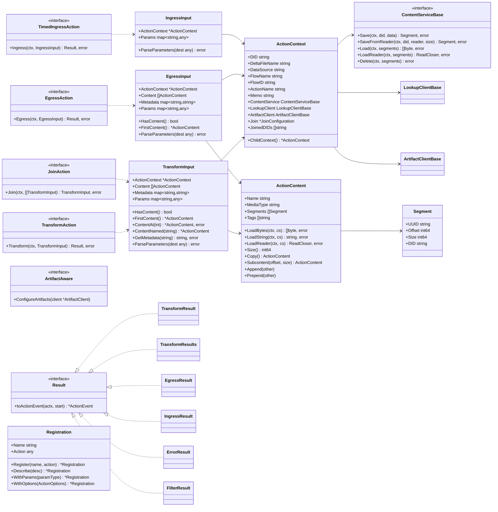
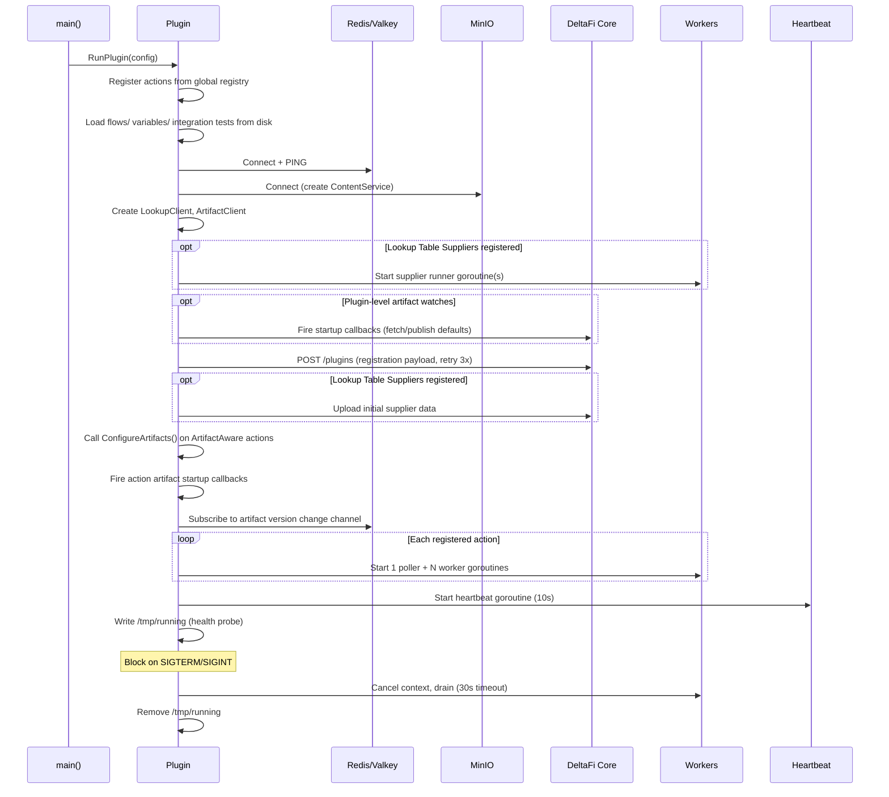
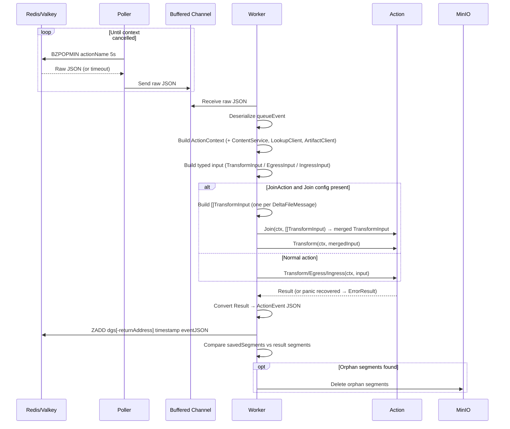

# DeltaFi Go Action Kit — Design Document

The Go Action Kit (`deltafi-go-action-kit`) is a library that handles the boilerplate of communicating with DeltaFi core so that plugin authors only need to implement their action logic. It manages: polling for work from Redis/Valkey queues, executing actions, storing content in MinIO/S3, registering the plugin with core, querying lookup tables, managing artifacts, and sending heartbeats.

Java and Python action kits already exist. This document describes the Go implementation.

---

## Module Layout

```
deltafi-go-action-kit/            # Library — flat package: actionkit
  go.mod
  actionkit.go                    # PluginCoordinates, ActionContext, Variable, FlowPlan, SafeStringMap
  action.go                       # Action interfaces (Transform, Egress, TimedIngress, Join, ArtifactAware)
  artifact.go                     # ArtifactClient, publish/get/stream, caching, version change callbacks
  content.go                      # Segment, ActionContent, ContentService (MinIO), content operations
  datasize.go                     # DataSize parameter type (human-readable byte sizes)
  envvar.go                       # EnvVar parameter type (UPPER_SNAKE_CASE env var references)
  errors.go                       # Domain-specific error types (MissingMetadataError, ExpectedContentError)
  event.go                        # ActionEvent wire format (JSON published to result queue)
  heartbeat.go                    # Heartbeat goroutine and long-running task reporting
  input.go                        # TransformInput, EgressInput, IngressInput, parameter coercion
  log.go                          # LogMessage and LogSeverity constants
  lookup.go                       # LookupClient, LookupTableSupplier, pull-through supplier runner
  options.go                      # ActionOptions, InputSpec, OutputSpec, ContentSpec
  plugin.go                       # Plugin struct, RunPlugin(), lifecycle orchestration
  queue.go                        # ActionEventQueue (Redis/Valkey BZPOPMIN/ZADD operations)
  registration.go                 # pluginRegistration payload, HTTP POST to core with retry
  registry.go                     # Global action/supplier/watch registries, Registration builder
  result.go                       # Result types: Transform, TransformResults, Egress, Ingress, Error, Filter
  schema.go                       # JSON Schema generation with $ref resolution and default coercion
  testing.go                      # InMemoryContentStore, MockLookupClient, MockArtifactClient, TestContext
  worker.go                       # Poller, worker pool, action execution, join dispatch, orphan cleanup
```

---

## Type Model Diagram



---

## Plugin Lifecycle Sequence Diagram



---

## Action Execution Sequence Diagram



---

## Action Code Examples

### Transform Action with Typed Parameters

```go
package actions

import (
    "context"
    "fmt"

    ak "github.com/deltafi/deltafi/deltafi-go-action-kit"
)

type UpperParams struct {
    Prefix string `json:"prefix" jsonschema:"description=Prefix to prepend,default=HELLO"`
}

type UpperTransform struct{}

func init() {
    ak.Register("UpperTransform", &UpperTransform{}).
        Describe("Uppercases content and prepends a prefix").
        WithParams(UpperParams{})
}

func (a *UpperTransform) Transform(ctx context.Context, input ak.TransformInput) (ak.Result, error) {
    actx := input.ActionContext
    var params UpperParams
    if err := input.ParseParameters(&params); err != nil {
        return actx.Errorf("parse parameters: %v", err), nil
    }

    content := input.FirstContent()
    data, err := content.LoadString(ctx)
    if err != nil {
        return nil, err
    }

    output := fmt.Sprintf("%s: %s", params.Prefix, strings.ToUpper(data))
    saved, err := actx.SaveString(ctx, output, content.Name, "text/plain")
    if err != nil {
        return nil, err
    }

    result := ak.NewTransformResult(actx)
    result.AddContent(*saved)
    return result, nil
}
```

### Egress Action

```go
type FileEgress struct{}

func init() {
    ak.Register("FileEgress", &FileEgress{}).
        Describe("Writes content to a local file")
}

func (a *FileEgress) Egress(ctx context.Context, input ak.EgressInput) (ak.Result, error) {
    actx := input.ActionContext
    content := input.FirstContent()
    data, err := content.LoadBytes(ctx)
    if err != nil {
        return nil, err
    }

    if err := os.WriteFile("/tmp/"+content.Name, data, 0644); err != nil {
        return actx.Errorf("write file: %v", err), nil
    }

    result := ak.NewEgressResult(actx)
    result.LogInfo(fmt.Sprintf("Wrote %d bytes to %s", len(data), content.Name))
    return result, nil
}
```

### Timed Ingress Action with Memo

```go
type PollingIngress struct{}

func init() {
    ak.Register("PollingIngress", &PollingIngress{}).
        Describe("Creates a DeltaFile on each invocation with an incrementing counter")
}

func (a *PollingIngress) Ingress(ctx context.Context, input ak.IngressInput) (ak.Result, error) {
    counter := 0
    if input.ActionContext.Memo != "" {
        fmt.Sscanf(input.ActionContext.Memo, "%d", &counter)
    }
    counter++

    content, err := ak.SaveContentString(ctx, input.ActionContext.ContentService,
        input.ActionContext, fmt.Sprintf("message %d", counter),
        "message.txt", "text/plain")
    if err != nil {
        return nil, err
    }

    item := ak.NewIngressResultItem(fmt.Sprintf("msg-%d.txt", counter))
    item.AddContent(*content)

    result := ak.NewIngressResult(input.ActionContext)
    result.AddItem(*item)
    result.SetMemo(fmt.Sprintf("%d", counter))
    return result, nil
}
```

### Join Action

```go
type MergingTransform struct{}

func init() {
    ak.Register("MergingTransform", &MergingTransform{}).
        Describe("Merges multiple DeltaFiles into one")
}

// Join is called before Transform when multiple DeltaFileMessages arrive.
func (a *MergingTransform) Join(ctx context.Context, inputs []ak.TransformInput) (ak.TransformInput, error) {
    return ak.DefaultJoin(inputs), nil
}

func (a *MergingTransform) Transform(ctx context.Context, input ak.TransformInput) (ak.Result, error) {
    result := ak.NewTransformResult(input.ActionContext)
    for _, c := range input.Content {
        result.AddContent(c)
    }
    return result, nil
}
```

### Multi-Child Split Transform

```go
type SplitTransform struct{}

func init() {
    ak.Register("SplitTransform", &SplitTransform{}).
        Describe("Splits each input content item into a separate child DeltaFile")
}

func (a *SplitTransform) Transform(ctx context.Context, input ak.TransformInput) (ak.Result, error) {
    results := ak.NewTransformResults(input.ActionContext)

    for _, c := range input.Content {
        child := ak.NewChildTransformResult(input.ActionContext, c.Name)
        child.AddContent(c)
        results.AddChild(*child)
    }

    return results, nil
}
```

---

## Lookup Table Service

### LookupClient API

The `LookupClient` is created automatically by the plugin and made available on every `ActionContext`. Actions query lookup tables through it:

```go
results, err := input.ActionContext.LookupClient.Lookup(ctx, "my-table", &actionkit.LookupOptions{
    MatchingColumnValues: map[string][]string{"status": {"active"}},
    ResultColumns:        []string{"name", "value"},
    SortColumn:           "name",
    SortDirection:        actionkit.SortASC,
    Offset:               intPtr(0),
    Limit:                intPtr(100),
})

// results.TotalCount, results.Rows ([]map[string]string), results.Created, results.Modified
```

### Caching

- Success TTL: 30s default, configurable via `TABLE_LOOKUP_CACHE_TTL` env var or `SetCacheTTL()`
- Failure TTL: 1s default, configurable via `TABLE_LOOKUP_FAILURE_CACHE_TTL`
- Cache key: SHA-256 of table name + serialized options
- `ClearCache()` evicts all entries

### LookupTableSupplier

Plugins can serve as lookup table data sources by implementing `LookupTableSupplier`:

```go
type LookupTableSupplier interface {
    Table() LookupTableDefinition
    GetRows(ctx, variables map[string]string, matchingColumnValues map[string][]string,
            resultColumns []string) ([]map[string]string, error)
}
```

The `LookupTableDefinition` is included in registration and supports pull-through queries, refresh intervals, and key columns.

Suppliers are registered via `actionkit.RegisterSupplier(supplier)` from `init()`. On startup:

1. The supplier runner goroutine starts before registration (so it can respond to core queries during registration processing)
2. After registration, initial data is fetched from each supplier and uploaded via `POST /api/v2/lookup/{tableName}`
3. The runner listens for `lookupTableEvent` messages on per-table Redis queues, dispatches to the matching supplier, and publishes `lookupTableEventResult` responses

### Table Upload

```go
client.UploadTable(ctx, "my-table", "application/json", jsonData)
// or
client.UploadTable(ctx, "my-table", "text/csv", csvData)
```

---

## Artifact Registry Service

### ArtifactClient API

The `ArtifactClient` is created automatically by the plugin and made available on every `ActionContext`. It publishes and retrieves artifacts via core's REST API (`/api/v2/artifacts`). Artifacts are scoped to the plugin's namespace or the `shared` namespace.

```go
actx := input.ActionContext

// Publish
resp, err := actx.ArtifactClient.PublishArtifact(ctx, "model.bin", reader, "application/octet-stream",
    &actionkit.PublishOptions{
        Version:     "2.1",
        Description: "Trained ML model",
        MakeActive:  boolPtr(true),
        Alias:       "production",
        Labels:      map[string]string{"env": "prod"},
    })

// Get (fully downloads into memory, cached)
fetched, err := actx.ArtifactClient.GetArtifact(ctx, "model.bin", "active")
// fetched.Data, fetched.Manifest.Version, fetched.Manifest.SHA256, ...

// Stream (bypasses cache, caller must close Reader)
stream, err := actx.ArtifactClient.StreamArtifact(ctx, "model.bin", "active")
defer stream.Reader.Close()

// Shared namespace variants
actx.ArtifactClient.PublishSharedArtifact(...)
actx.ArtifactClient.GetSharedArtifact(...)
actx.ArtifactClient.StreamSharedArtifact(...)
```

### Caching

- Success TTL: 10s default, configurable via `ARTIFACT_CACHE_TTL` env var or `SetCacheTTL()`
- Failure TTL: 1s default, configurable via `ARTIFACT_FAILURE_CACHE_TTL`
- Cache is automatically invalidated when the same client publishes an artifact
- `ClearCache()` evicts all entries
- Stream operations bypass the cache entirely

### Version Change Callbacks

The artifact listener subscribes to the `deltafi:artifact:version-changed` Valkey pub/sub channel. When a version change event arrives:

1. The cache is invalidated for that artifact
2. Registered callbacks matching the event's owner, artifact name, and alias are invoked

Callback registration methods:

```go
// Raw event callback
client.OnUpdate("model.bin", "active", func(event VersionChangedEvent) { ... })
client.OnSharedUpdate("config.json", "", func(event VersionChangedEvent) { ... })

// Auto-fetch callbacks (fetches artifact and passes to handler)
client.OnUpdateFetch("model.bin", "", func(fetched *FetchedArtifact, err error) { ... })
client.OnSharedUpdateFetch("shared-config", "", func(fetched *FetchedArtifact, err error) { ... })

// Auto-fetch with default (publishes default data if artifact not found)
client.OnUpdateFetchWithDefault("rules.json", "", defaultArtifact, handler)
client.OnSharedUpdateFetchWithDefault("shared-rules.json", "", defaultArtifact, handler)
```

### ArtifactAware Interface

Actions that need to register callbacks implement `ArtifactAware`:

```go
type ArtifactAware interface {
    ConfigureArtifacts(client *ArtifactClient)
}
```

Called once during plugin startup after registration but before workers begin processing.

### Plugin-Level Artifact Watches

For artifacts needed at the plugin level (not per-action), use the global registry:

```go
func init() {
    actionkit.WatchArtifact("config.json", &actionkit.ArtifactDefault{
        Data:        defaultConfigBytes,
        ContentType: "application/json",
        Description: "Default configuration",
    }, func(fetched *actionkit.FetchedArtifact, err error) {
        // update in-memory config
    })
}
```

Plugin-level watches fire before registration, ensuring data is available when core processes the registration.

### WatchArtifact Startup Sequence

1. Plugin-level watches (`WatchArtifact`/`WatchSharedArtifact`) are set up and fired before registration
2. After registration, `ConfigureArtifacts()` is called on each `ArtifactAware` action
3. `FireStartupCallbacks()` fires any callbacks added during step 2
4. The pub/sub listener starts for ongoing version change events

---

## JSON Schema Generation

`GenerateSchema(paramType any) map[string]any` produces a JSON Schema from a Go struct using `github.com/invopop/jsonschema`.

### Process

1. Reflect struct → raw schema (via `jsonschema.Reflector`)
2. Resolve top-level `$ref` (the library produces `{"$ref":"#/$defs/T","$defs":{...}}`)
3. Recursively walk the schema to:
   - Inline all `$ref` pointers from `$defs`
   - Set `additionalProperties: false` on object types (structs only, not maps)
   - Coerce string default values to proper JSON types (boolean, integer, number, array, object)
4. Remove `$schema`, `$id`, `$defs` fields that core does not expect

### Struct Tags

```go
type MyParams struct {
    Name   string `json:"name"   jsonschema:"description=The display name,default=unnamed"`
    Mode   string `json:"mode"   jsonschema:"enum=fast,enum=slow,enum=auto"`
    Count  int    `json:"count"  jsonschema:"default=10,minimum=0,maximum=100"`
    Active bool   `json:"active" jsonschema:"default=true"`
    Label  string `json:"label"  jsonschema:"required"`
}
```

Use `\\,` to include a literal comma in a value.

### Special Types

**`DataSize`** — Serializes as a string like `"10MB"`. Schema: `{"type":"string","pattern":"^[0-9]+(B|KB|MB|GB|TB)$","x-deltafi-type":"DataSize"}`.

```go
type MyParams struct {
    MaxSize actionkit.DataSize `json:"maxSize" jsonschema:"default=10MB"`
}
// Usage: params.MaxSize.Bytes() → 10485760
```

**`EnvVar`** — Stores an environment variable name (UPPER_SNAKE_CASE), resolved at runtime. Schema: `{"type":"string","pattern":"^[A-Z][A-Z0-9_]*$","x-deltafi-type":"EnvVar"}`.

```go
type MyParams struct {
    APIKey actionkit.EnvVar `json:"apiKey"`
}
// Usage: secret, err := params.APIKey.Resolve()
//        secret := params.APIKey.ResolveOrDefault("fallback")
```

Both types implement `jsonschema.JSONSchemaer` for custom schema generation and `json.Marshaler`/`json.Unmarshaler` for proper serialization.

---

## Type-Aware Parameter Coercion

DeltaFi core may send all action parameters as strings after variable substitution. `parseRawParams` coerces values to match the destination struct's field types before JSON unmarshaling:

1. Build a map of JSON field names → `reflect.Kind` from the destination struct
2. For each parameter value:
   - **String → numeric field**: Parse as int/uint/float
   - **String → bool field**: Convert `"true"`/`"false"` to `bool`
   - **Numeric → string field**: Format as string via `strconv.FormatFloat`
   - **Map → struct/ptr field**: Recurse into nested structs
   - **Unknown target type**: Best-effort coercion (try bool, int, float, fallback to string)
3. Marshal the coerced map to JSON and unmarshal into the destination struct

---

## Registration Builder Pattern

Actions self-register via `init()` functions using a fluent builder:

```go
func init() {
    actionkit.Register("MyAction", &MyAction{}).
        Describe("Transforms data by doing X").
        WithParams(MyParams{}).
        WithOptions(actionkit.ActionOptions{
            InputSpec: &actionkit.InputSpec{
                ContentSummary: "Expects a single JSON document",
            },
            OutputSpec: &actionkit.OutputSpec{
                ContentSummary: "Produces a transformed JSON document",
            },
            Errors: actionkit.SimpleErrors("Invalid JSON input"),
            Filters: actionkit.SimpleFilters("Empty content"),
        })
}
```

### Builder Chain

`Register(name, action)` → `*Registration` with methods:

- `.Describe(desc)` — Sets human-readable description
- `.WithParams(paramType)` — Sets parameter struct type for JSON schema generation
- `.WithOptions(ActionOptions)` — Sets input/output specs, error/filter conditions, notes. If `options.Description` is non-empty and no description was set, it populates the description.

### Global Registries

- `actionkit.All()` — Returns all registered actions
- `actionkit.AllSuppliers()` — Returns all registered lookup table suppliers
- `actionkit.RegisterSupplier(supplier)` — Registers a lookup table supplier from `init()`
- `actionkit.WatchArtifact(...)` / `actionkit.WatchSharedArtifact(...)` — Registers plugin-level artifact watches from `init()`

`RunPlugin()` iterates all registries to populate the plugin.

---

## Test Framework

### In-Memory Content Store

`InMemoryContentStore` implements `ContentServiceBase` with a `map[string][]byte`. Supports all operations: `Save`, `SaveFromReader`, `Load`, `LoadReader`, `Delete`.

Convenience methods for test setup:

```go
store.CreateContent(did, name, mediaType, data)        // returns ActionContent
store.CreateStringContent(did, name, mediaType, str)   // returns ActionContent
```

### Mock Clients

**`MockLookupClient`** — Implements `LookupClientBase`. Configure via:
- `.Results` map for canned responses per table name
- `.LookupFunc` for custom logic (takes precedence over `.Results`)
- `.Err` for global error override
- `.LookupCalls` records all calls for assertion

**`MockArtifactClient`** — Implements `ArtifactClientBase`. Configure via:
- `.Artifacts` map for canned get responses (keyed `"plugin/name"` or `"shared/name"`)
- `.PublishResponse` for publish return value
- `.Err` for global error override
- `.PublishCalls` records all publish calls for assertion

### TestContext

```go
tc := actionkit.NewTestContext("test-did-123")
// tc.ActionContext — pre-wired with InMemoryContentStore, test defaults
// tc.Store — the underlying InMemoryContentStore

content := tc.Content("file.txt", "text/plain", "hello world")

input := actionkit.TransformInput{
    ActionContext: tc.ActionContext,
    Content:       []actionkit.ActionContent{content},
    Metadata:      map[string]string{"key": "value"},
}
```

The `ActionContext` is pre-populated with test values (DID, flow name, action name, etc.) and wired to the in-memory content store.

### Action Runners

```go
event := actionkit.RunTransform(t, &MyTransform{}, input)   // fails test on Go error
event := actionkit.RunEgress(t, &MyEgress{}, input)
event := actionkit.RunIngress(t, &MyIngress{}, input)
```

### Result Assertions

```go
event.RequireTransform(t)           // asserts type=TRANSFORM, returns []TransformEvent
event.RequireError(t, "bad input")  // asserts type=ERROR with matching cause
event.RequireFilter(t, "too small") // asserts type=FILTER with matching message
event.RequireEgress(t)              // asserts type=EGRESS
event.RequireIngress(t)             // asserts type=INGRESS, returns *IngressEvent
```

### ResultEvent

For lower-level inspection, `ResultEvent(result, actx)` converts any `Result` to an `*ActionEvent` with all fields exported.

---

## Multi-Child Splitting

Transform actions can produce multiple child DeltaFiles from a single input using `TransformResults`:

```go
results := actionkit.NewTransformResults(actx)

child1 := actionkit.NewChildTransformResult(actx, "part-1.txt")
child1.AddContent(content1)
child1.AddMetadata("index", "1")
results.AddChild(*child1)

child2 := actionkit.NewChildTransformResult(actx, "part-2.txt")
child2.AddContent(content2)
results.AddChild(*child2)

return results, nil
```

`NewChildTransformResult` calls `actx.ChildContext()`, which generates a new UUID for the child DeltaFile while inheriting the parent's flow context, content service, lookup client, and artifact client.

Each child produces a separate `TransformEvent` in the `ActionEvent.Transform` array, each with its own DID, content, metadata, and annotations.

---

## Content Operations

### Save

```go
// Byte slice
content, err := actionkit.SaveContent(ctx, cs, actx, data, "output.json", "application/json")

// String
content, err := actionkit.SaveContentString(ctx, cs, actx, jsonStr, "output.json", "application/json")

// Streaming (size=-1 for unknown)
content, err := actionkit.SaveContentFromReader(ctx, cs, actx, reader, size, "output.bin", "application/octet-stream")
```

All save helpers track segments on the ActionContext for orphan cleanup.

### Load

Content received through an action input (TransformInput, EgressInput, etc.)
and content returned from the SaveContent helpers is wired to its
ActionContext, so load methods only need the cancellation context:

```go
data, err := content.LoadBytes(ctx)          // []byte
str, err := content.LoadString(ctx)           // string
reader, err := content.LoadReader(ctx)        // io.ReadCloser (caller must close)
```

Content constructed directly (via struct literal or `Store.CreateContent`
without going through TestContext.Content) has no ActionContext back-reference
and will return an error from these methods. Load such content explicitly via
`cs.Load(ctx, content.Segments)`.

### Manipulate (no I/O)

```go
copied := content.Copy()                                      // deep copy
sub := content.Subcontent(offset, size)                        // byte range view
sub := content.SubcontentNamed(offset, size, "part", "text/plain")

content.Append(other)      // append other's segments
content.Prepend(other)     // prepend other's segments
content.SetName("new.txt")
content.SetMediaType("text/plain")
content.AddTag("processed")
content.RemoveTag("raw")
has := content.HasTag("processed")
total := content.Size()    // sum of segment sizes
```

`Subcontent` adjusts segment offsets and sizes to reference a byte range without fetching data from storage.

---

## ActionOptions

`ActionOptions` documents an action's expected inputs, outputs, error conditions, and filter conditions for the DeltaFi UI.

```go
type ActionOptions struct {
    Description string
    InputSpec   *InputSpec
    OutputSpec  *OutputSpec
    Filters     []DescriptionWithConditions
    Errors      []DescriptionWithConditions
    Notes       []string
    Details     string
}
```

- `InputSpec` — ContentSummary, ContentSpecs (name/mediaType/description), MetadataSummary, MetadataDescriptions
- `OutputSpec` — Same as InputSpec plus Passthrough, AnnotationsSummary, AnnotationDescriptions
- `SimpleFilters("reason1", "reason2")` / `SimpleErrors("error1", "error2")` — Shorthand for condition-less entries

---

## Environment Variables

| Variable | Default | Description |
|----------|---------|-------------|
| `CORE_URL` | `http://deltafi-core-service` | DeltaFi core API URL |
| `VALKEY_URL` | `deltafi-valkey-master:6379` | Redis/Valkey host:port |
| `VALKEY_PASSWORD` | `""` | Redis/Valkey password |
| `MINIO_URL` | `deltafi-minio:9000` | MinIO endpoint (scheme prefix stripped) |
| `MINIO_ACCESSKEY` | `deltafi` | MinIO access key |
| `MINIO_SECRETKEY` | `password` | MinIO secret key |
| `STORAGE_BUCKET_NAME` | `storage` | S3 bucket name |
| `IMAGE` | `""` | Container image URI |
| `IMAGE_PULL_SECRET` | `""` | K8s image pull secret |
| `PROJECT_GROUP` | `""` | Plugin group ID (PluginCoordinates.GroupID) |
| `PROJECT_NAME` | `""` | Plugin artifact ID (also used as display name fallback) |
| `PROJECT_VERSION` | `""` | Plugin version |
| `APP_NAME` | (hostname) | Container/pod name for task tracking |
| `ACTION_THREADS` | `1` | Default worker count for all actions |
| `ACTIONS_ACTIONTHREADS_{NAME}` | (none) | Per-action worker count override (dots/hyphens → underscores, uppercased) |
| `TABLE_LOOKUP_CACHE_TTL` | `30s` | Lookup result cache TTL (integer seconds or Go duration) |
| `TABLE_LOOKUP_FAILURE_CACHE_TTL` | `1s` | Lookup failure cache TTL |
| `ARTIFACT_CACHE_TTL` | `10s` | Artifact download cache TTL |
| `ARTIFACT_FAILURE_CACHE_TTL` | `1s` | Artifact failure cache TTL |

---

## Dependencies

```
github.com/redis/go-redis/v9       # Redis/Valkey client
github.com/minio/minio-go/v7       # MinIO/S3 client
github.com/google/uuid             # UUID generation
github.com/invopop/jsonschema      # JSON Schema from Go structs
```
